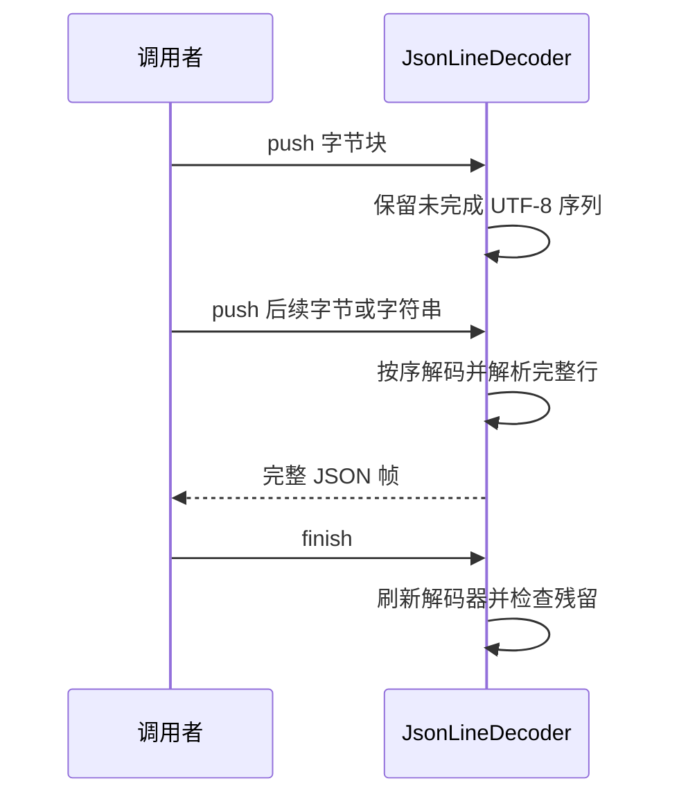

# JSONL 字节流解码

## 行为与所有权

JsonLineDecoder 是未完成文本和 UTF-8 解码状态的唯一所有者。每个连接使用独立实例，调用者按接收顺序调用 push，结束时调用 finish。

## 不变量与失败语义

- 合法 UTF-8 JSONL 输入在任意字节切分下产生相同帧。
- 字符串块已经解码；先刷新挂起字节，再追加字符串，维持输入顺序。
- finish 必须刷新字节解码状态，非空残留仍报 Incomplete JSONL frame。
- 保留 TextDecoder 默认替换非法字节的行为、现有帧大小限制、空行处理及 JSON 解析错误。
- 不引入异步任务、重试、持久化、恢复或额外状态副本。传输层的桌面连续流和手机可恢复交付语义不变；此解码器只消费当前有序连接。

## 验收与迁移边界

覆盖中文、emoji、四字节字符及替换字符的每个切分位置；覆盖截断尾字节和字节/字符串混合输入。公开接口及协议格式不变，无需迁移或新增跨模块依赖。
